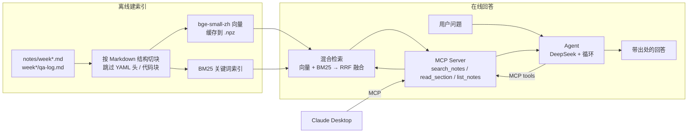

# 项目 1：学习笔记问答 Agent（RAG + MCP）

把我学习大模型 / AI Agent 的每周笔记和问答记录做成知识库，用 **混合检索 + 自己写的 MCP Server + Agent** 来回答问题。
同一个 MCP Server 既能给自己写的 Agent 用，也能直接接进 Claude Desktop。

## 架构



## 文件

| 文件 | 作用 |
|---|---|
| `kb.py` | 知识库核心：切块、bge 向量、BM25、RRF 混合检索、向量缓存 |
| `server.py` | MCP Server，3 个工具；默认 stdio，`--http` 变成远程服务 |
| `agent.py` | 学习助手 Agent（第 4 周的 agent 循环 + 本项目的 Server） |
| `eval.py` | 评测：vector / bm25 / hybrid 三种检索方式在同一批题上比较 Hit@1、Hit@4，以及门槛误挡率 |

## 快速开始

```bash
cd ~/ai-learning && source .venv/bin/activate
python week5/project1/eval.py          # 先评测（第一次会建索引，之后读缓存）
python week5/project1/agent.py         # 开始提问
```

远程模式：一个终端跑 `python week5/project1/server.py --http`，另一个终端跑 `python week5/project1/agent.py --http`。

## 接入 Claude Desktop

编辑 `~/Library/Application Support/Claude/claude_desktop_config.json`：

```json
{
  "mcpServers": {
    "jet-notes": {
      "command": "/Users/jetli/ai-learning/.venv/bin/python",
      "args": ["/Users/jetli/ai-learning/week5/project1/server.py"]
    }
  }
}
```

## 技术选型与理由

| 环节 | 选择 | 为什么 |
|---|---|---|
| Embedding | BAAI/bge-small-zh-v1.5（4 层，512 维，约 95MB） | 中文好、Mac CPU 就能跑、免费；缺点是英文术语弱 |
| 关键词检索 | 自己写的 BM25（中文按相邻两字切） | 补上向量检索对 `tool_call_id`、`GPT-2` 这类专有名词的短板 |
| 融合 | RRF（倒数排名融合） | 两种分数单位不同，不能直接相加；只比名次最稳 |
| 向量存储 | numpy + .npz 缓存 | 不到 100 块，暴力计算只要几毫秒；上万块再换向量数据库（pgvector / Milvus） |
| 生成 | DeepSeek（OpenAI 兼容接口） | 便宜，中文好 |
| 协议 | MCP（stdio / Streamable HTTP） | 一次开发，Agent 和 Claude Desktop 都能用 |

## 评测结果

在 12 道能答的题 + 2 道笔记里没讲过的题上（bge-small-zh，门槛 0.55，k=4）：

| 模式 | Hit@1 | Hit@4 |
|---|---|---|
| vector | 9/12 | 11/12 |
| bm25 | 8/12 | 12/12 |
| **hybrid** | **11/12** | **12/12** |

- **结论**：混合检索把 Hit@1 从 9/12 提到 11/12。向量会漏专有名词，BM25 不懂换说法，两路正好互补。
- 门槛 0.55 没有误挡任何一道能答的题（0/12），但**两道"笔记里没讲过"的题（vLLM 部署、LoRA）都没挡住**：它们和笔记同属大模型领域，相似度天然就高。
- 第二道防线有效：问 Agent"LoRA 微调的原理是什么"，它读完片段后判断笔记里没有，并标注了"（笔记外补充）"。

## 踩过的坑（第 5 周学到的）

- **切块太碎**，一句话被切成两半，答案散到多块里，top-k 装不下 → 按小标题 / 段落切，并加上重叠。
- **门槛凭感觉定成 0.7**，跑完测试集才发现 12 道能答的题只放行 2 道 → 门槛要拿测试集扫一遍来定，而且是业务取舍（客服宁严勿松）。
- **中英混合的问题**（"AccessKey 传到 GitHub"）向量检索排不到第一 → 加 BM25 做混合检索。
- **关键词打分太死板**，模型换了说法就判错 → 关键词初筛 + LLM 裁判复核。
- **同领域但没讲过的问题，门槛挡不住**（LoRA、vLLM 都过了 0.55）→ 门槛只防跑题；要靠 prompt 让 LLM 判断资料够不够，再加 rerank 模型。
- **stdio 模式往 stdout print** 会把 MCP 协议搞乱 → 日志写 stderr。

## 下一步

- 加 rerank 模型（如 bge-reranker）做二次排序
- 测试集扩到 50 道以上，避免过拟合测试集
- 部署成 HTTP 服务，加鉴权
